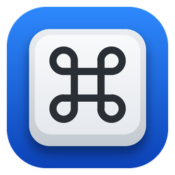

# AluKeys

Свободная программа, которая делает клавиатуры Apple удобными в Windows 10/11. Без подписки, без телеметрии, без драйвера ядра.

[English](README.md)

Сделана для Apple Wireless Keyboard A1314 (алюминиевая, от iMac 2009–2011), но должна работать и с A1255 и проводными A1242/A1243.

## Что умеет

- **fn работает.** fn + ←/→/↑/↓ дают Home/End/PgUp/PgDn, fn + Backspace — Delete, fn + Enter — Insert, fn + P/K/B — PrintScreen/ScrollLock/Pause.
- **Eject работает** как Delete с автоповтором, fn + Eject — как Insert.
- **Верхний ряд как на Mac:**
  - F1/F2 меняют яркость, в том числе внешних мониторов через DDC/CI;
  - F3 — Представление задач, F4 — Пуск;
  - F7–F9 — музыка, F10–F12 — громкость со штатным индикатором Windows.
  - fn + F-клавиша даёт обычные F1–F12, fn + Esc переключает режим ряда (fn-lock).
  - Пока зажат Ctrl, Option, Cmd или Shift, ряд всегда работает как F1–F12, поэтому Alt+F4 и Ctrl+F5 нажимаются без fn.
- **Сочетания как на Mac (по умолчанию).** ⌘ работает как Ctrl, поэтому ⌘C, ⌘V, ⌘Z, ⌘T, ⌘W, ⌘+клик и ⌘+колесо делают привычное. Кроме того:

  | Сочетание | Что делает |
  |---|---|
  | ⌘Tab | переключает окна |
  | ⌘Q | закрывает окно |
  | ⌘Space | переключает язык ввода |
  | ⌃Space | открывает поиск в Пуске (как Spotlight) |
  | ⌘←/→ | начало/конец строки |
  | ⌥←/→ | на слово назад/вперёд |
  | ⌥⌫ | удаляет слово |
  | ⌘⇧3 / ⌘⇧4 | скриншот всего экрана / области |
  | ⌃⌘Q | блокирует компьютер |
  | ⌘⌥Esc | открывает Диспетчер задач |
  | ⌃←/→ | переключает рабочие столы |

  - fn + ⌘ работает как клавиша Windows.
  - Каждое правило можно выключить.
- **Типографика через ⌥, как на Mac.** Символы печатаются в любой раскладке и любой программе. Набор можно изменить или выключить.

  | ⌥ + | Символ | ⌥ + ⇧ + | Символ |
  |---|---|---|---|
  | - | – | - | — |
  | Ж (;) | « | Ж (;) | » |
  | 4 | ₽ | | |
  | 8 | • | 8 | ° |
  | 0 | º | | |
  | = | ≠ | = | ± |
  | Ю (.) | … | | |
  | 2 | ™ | 2 | € |
  | [ | “ | [ | ” |
  | ] | ‘ | ] | ’ |
  | , | „ | | |
  | G / X / / | © / × / ÷ | | |
- **Пресеты модификаторов.** Кроме «Как на Mac» есть «Как на ПК» (⌥ и ⌘ меняются местами, получается Ctrl | Win | Alt) и «Без изменений».
- **Клавиши ё и §.** На ISO-клавиатуре они меняются местами автоматически, как в macOS: с раскладкой «Русская» ё стоит слева от 1.
- **Батарея.** Если клавиатура сообщает заряд, он виден в трее, а при 20/10/5 % приходит уведомление. Apple Wireless Keyboard A1314 в Windows заряд не сообщает: она отдаёт его только по запросу, а драйвер HID в Windows такой запрос не пропускает.
- **Окно настроек:**
  - карта именно вашей клавиатуры с символами ваших раскладок (EN и RU);
  - слои «без модификатора / fn / ⌘ / ⌥ / ⌃», которые переключаются сами, если зажать модификатор;
  - живой тестер «нажали → что получила Windows»;
  - свои сочетания, мастер первого запуска.
- **Работа в окнах администратора.** Автозапуск с правами администратора делает так, что переназначения действуют и в Диспетчере задач, и в терминалах администратора. Windows спросит разрешение один раз.
- **Безопасность.** Ничего не залипает: при блокировке, сне, отключении клавиатуры и паузе все клавиши отпускаются.

## Установка

1. Скачайте `AluKeys-x64.zip` (или `-arm64`) из раздела Releases и распакуйте в удобную папку, например `%LOCALAPPDATA%\Programs\AluKeys`.
2. Подключите клавиатуру в «Параметры → Bluetooth и устройства».
3. Запустите `alukeys.exe`. Откроется мастер первого запуска.

Программа не подписана, поэтому SmartScreen может предупредить: «Подробнее → Выполнить в любом случае».

Чтобы держать всё в одной папке (портативный режим), положите рядом с exe пустой файл `portable`.

## Если что-то не работает

Запустите `alukeys-diag.exe`, следуйте подсказкам и приложите `alukeys-diag-report.txt` к issue. Журнал программы лежит в `%APPDATA%\AluKeys\alukeys.log`.

- **Не работает fn или Eject.** Проверьте, не установлены ли драйверы Boot Camp или Magic Utilities: они перехватывают эти клавиши сами.
- **Яркость не меняется.** Монитор должен поддерживать DDC/CI (обычно включается в меню монитора). Встроенные экраны ноутбуков пока не поддерживаются.
- **Не работает на экране входа в Windows.** Это ограничение Windows для программ: до входа в систему они не запускаются.

## Настройка

Всё настраивается в окне (щелчок по иконке в трее). Настройки хранятся в `%APPDATA%\AluKeys\config.toml`: файл можно править вручную, изменения применяются сразу.

```toml
preset = "mac"              # mac | pc | asis
iso_swap = "auto"           # auto | on | off
only_with_apple = true
disabled = ["ctrl-desktops"] # выключенные группы правил

[top_row]
mode = "media"              # media | function
function_with_modifiers = true
[top_row.keys]
F5 = "media_stop"

[remap]                     # клавиша → действие
CapsLock = "LCtrl"

[[rules]]                   # свои сочетания (модификаторы Apple)
trigger = "Cmd+Shift+T"
action = "Ctrl+Shift+T"

[battery]
warn_at = [20, 10, 5]
```

**Действия:**
- `Home` — работать как другая клавиша;
- `Ctrl+Shift+Esc` — нажать сочетание;
- `tap:LWin` — нажать одну клавишу;
- `Shift+Home, Backspace` — последовательность сочетаний;
- `volume_up`, `volume_down`, `mute`, `play_pause`, `next_track`, `prev_track`, `media_stop`;
- `brightness_up`, `brightness_down`;
- `browser_back`, `browser_forward`, `pause`;
- `fn_lock`, `lock`, `none`;
- `switcher:Alt+Tab`;
- `text:—` — напечатать символы;
- `vk:0x13` — виртуальный код клавиши.

**Модификаторы в `trigger`:** `Fn`, `Ctrl`, `Opt`, `Cmd`, `Shift`.

## Как это устроено

AluKeys — один exe без драйвера:

- `WH_KEYBOARD_LL` перехватывает и подменяет нажатия (`SendInput` по скан-кодам, поэтому сочетания работают и с русской раскладкой).
- fn и Eject клавиатура отправляет отдельным HID-отчётом, он читается через Raw Input.
- Батарея берётся из отчёта HID Battery Strength, если клавиатура присылает его сама.
- Окно настроек — WebView2. Оно создаётся по требованию и выгружается при закрытии, в фоне программа занимает несколько мегабайт.

Структура:
- `crates/alukeys-core` — платформонезависимый движок (раскладки, правила, конечный автомат), покрыт тестами;
- `crates/alukeys` — слой Windows (хук, Raw Input, трей, OSD, яркость, батарея, окно настроек);
- `crates/alukeys-diag` — диагностика.

Сборка (Windows, или кросс-компиляция с macOS/Linux через [cargo-xwin](https://github.com/rust-cross/cargo-xwin)):

```bash
cargo test -p alukeys-core
cargo build --release -p alukeys --target x86_64-pc-windows-msvc
```

## Лицензия

MIT. Проект не связан с Apple Inc. Apple, Mac и Magic Keyboard являются товарными знаками Apple Inc.
